# Procedimiento

Este documento registra paso a paso lo que fuimos haciendo, con las capturas que verifican cada resultado. Está pensado para leerse en orden.

Las partes siguen la numeración de [`GUIA.md`](GUIA.md), donde está la teoría. Los requisitos del trabajo están en [`CONSIGNA.md`](CONSIGNA.md).

| Parte | Tema | Programa |
|---|---|---|
| 1 | Preparar el entorno | — |
| 2 | Una función en ensamblador puro | `asm hello world/program.s` |
| 3 | C llamando a ensamblador, argumentos por registros | `main.c` + `suma.s` |
| 4 | Argumentos **por la pila** | `main2.c` + `suma_por_pila.s` + `suma2.s` |
| 5 | Detalles de la ABI: alineación, callee-saved y red zone | experimentos propios |

Trabajamos sobre el material del profesor: <https://gitlab.com/nicoborsottib/stackframe>

Todas las sesiones de GDB se hicieron con **gdb-dashboard**, que muestra registros, pila, memoria, desensamblado y código fuente al mismo tiempo, y los actualiza en cada paso.

---

# Parte 1: preparar el entorno

## 1.1 Herramientas

```bash
sudo apt install build-essential gdb
```

`build-essential` trae `gcc` (el compilador de C), `as` (el ensamblador) y `ld` (el enlazador).

## 1.2 gdb-dashboard

Sin el dashboard, GDB muestra la información de a partes: hay que pedir `info registers` para ver los registros y `x/4gx $rsp` para ver la memoria, y cada respuesta aparece suelta en la terminal. **gdb-dashboard** es un `.gdbinit` escrito en Python que reorganiza todo eso en paneles fijos (Assembly, Registers, Memory, Stack, Source, Expressions, Variables) y los vuelve a dibujar cada vez que el programa se detiene.

Se instala en la carpeta personal:

```bash
curl -fsSL -o ~/.gdbinit https://raw.githubusercontent.com/cyrus-and/gdb-dashboard/master/.gdbinit
echo "set debuginfod enabled off" >> ~/.gdbinit
```

La segunda línea desactiva *debuginfod*. Si no, GDB pregunta en cada sesión si queremos descargar símbolos desde internet, y no hace falta porque nuestros binarios ya traen los suyos.

> El repositorio del profesor trae un `setup.sh` que instala el archivo en la carpeta del proyecto. **Ese método no funciona**: por seguridad, GDB no carga automáticamente un `.gdbinit` del directorio actual. En la carpeta personal, en cambio, se carga siempre.

## 1.3 Verificación

```bash
uname -m
gcc --version | head -1
as --version | head -1
gdb --version | head -1
wc -l ~/.gdbinit
```

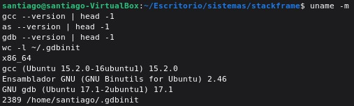

El entorno quedó así: arquitectura `x86_64`, gcc 15.2.0, binutils 2.46 y GDB 17.1. El `.gdbinit` tiene 2389 líneas, lo que confirma que el dashboard está instalado. Al abrir `gdb`, el prompt pasa a ser **`>>>`** en lugar de `(gdb)`.

## 1.4 Material del profesor

```bash
git clone https://gitlab.com/nicoborsottib/stackframe.git
cd stackframe
```

| Dónde | Archivos | Parte |
|---|---|---|
| `stackframe/asm hello world/` | `program.s` | 2 |
| `stackframe/` (raíz) | `main.c`, `suma.s` | 3 |
| `stackframe/` (raíz) | `main2.c`, `suma2.s`, `suma_por_pila.s` | 4 |

> **Cómo se usa GDB en este documento:** un comando por línea, apretando Enter y esperando la respuesta antes del siguiente. Si se pegan varias líneas juntas, GDB las toma como un solo comando y falla. Los `#` que aparecen en los bloques son explicaciones y no se escriben.

---

# Parte 2: una función en ensamblador puro

`program.s` no usa la biblioteca de C. Su punto de entrada, `_start`, llama a `calc_sum(10, 20)`. Esa función arma su propio marco de pila, guarda los argumentos como variables locales, los suma y devuelve el resultado en `%rax`. Después, el programa termina con la syscall `exit` y usa ese resultado como código de salida.

## 2.1 Compilar y ejecutar

```bash
cd "asm hello world"
as -g --gdwarf-2 -o program.o program.s
ld -o program program.o
./program
echo $?
```

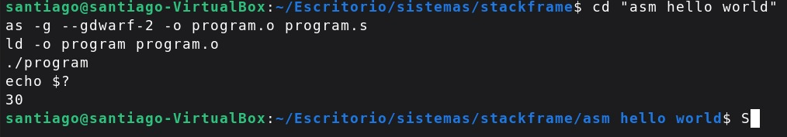

- **`-g --gdwarf-2`** incorpora información de depuración; sin eso, GDB no puede mostrar el código fuente.
- Se enlaza con **`ld`** directamente, no con `gcc`, porque el programa no usa la biblioteca de C y entra por `_start`.
- El programa no imprime nada. Su resultado es el **código de salida**, que se consulta con `echo $?` y vale **30** (10 + 20).

## 2.2 Estado inicial

```bash
gdb ./program
```

```
break _start
break calc_sum
run
info registers rsp rbp rip
```

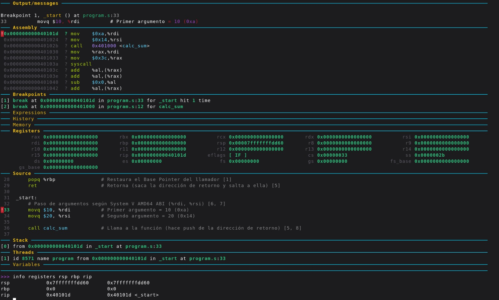

El programa se detiene en la primera instrucción de `_start` (`0x40101d`). En el panel **Breakpoints** se ve que el segundo punto de interrupción quedó en `0x401000`, la primera instrucción de `calc_sum`.

| Registro | Valor | Por qué |
|---|---|---|
| `%rsp` | `0x7fffffffdd60` | cima de la pila al arrancar; es la referencia contra la que comparamos todo lo que sigue |
| `%rbp` | `0x0` | `_start` es el punto de entrada del proceso: no la llamó nadie, así que no hay marco anterior |
| `%rip` | `0x40101d` | `<_start>` |

## 2.3 Los argumentos van a los registros

```
stepi
stepi
info registers rdi rsi
```

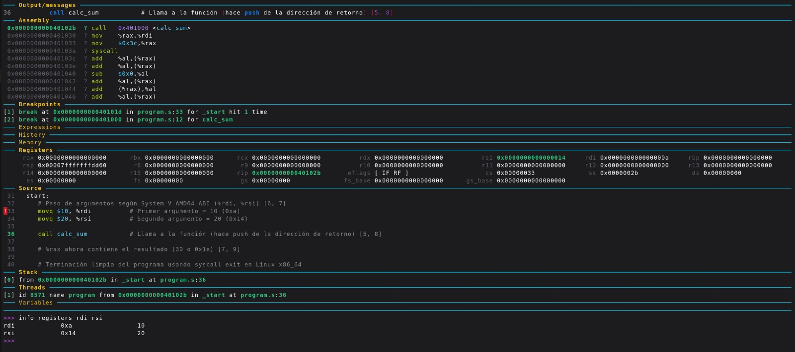

Los dos `stepi` ejecutan `movq $10,%rdi` y `movq $20,%rsi`. Quedan **`%rdi` = 10** (`0xa`) y **`%rsi` = 20** (`0x14`). Es la System V AMD64 ABI en acción: el primer argumento entero va en `%rdi` y el segundo en `%rsi`.

El panel Assembly muestra que la próxima instrucción es `call 0x401000 <calc_sum>`, en `0x40102b`.

## 2.4 La dirección de retorno

```
stepi
x/1gx $rsp
disassemble _start
```

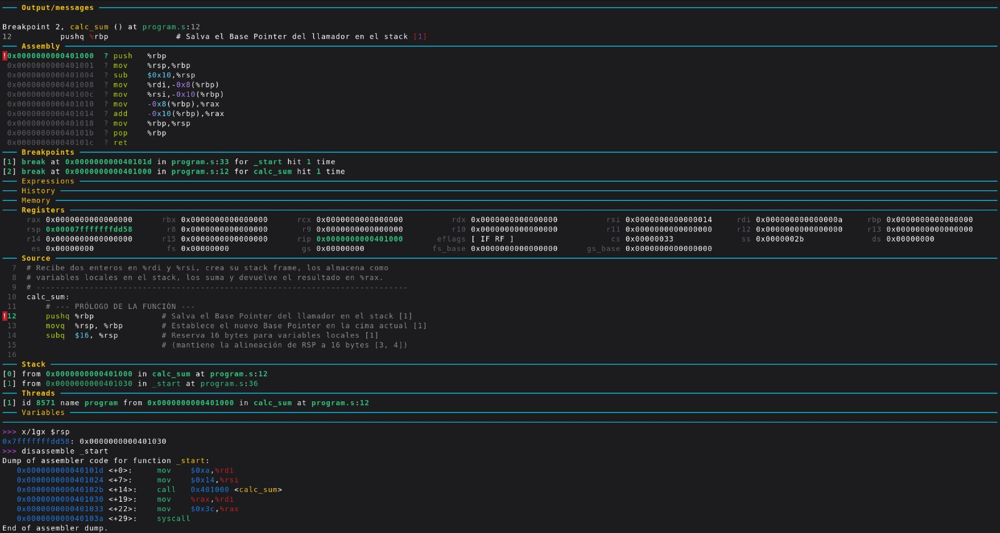

Este es el resultado central de la parte. Se verifican tres cosas a la vez:

1. **`%rsp` bajó 8 bytes**, de `…dd60` a `…dd58`. Lo hizo el `call` al apilar la dirección de retorno, y confirma que la pila crece hacia direcciones más bajas.
2. En la cima de la pila está el valor **`0x401030`**.
3. En el desensamblado de `_start`, `0x401030` es **`<+19>`**, la instrucción que sigue al `call`.

El panel **Stack** muestra lo mismo desde el lado del depurador: el marco `[1]` está en `0x401030 in _start`.

## 2.5 El prólogo arma el marco

```
stepi
stepi
stepi
info registers rsp rbp
x/4gx $rsp
```

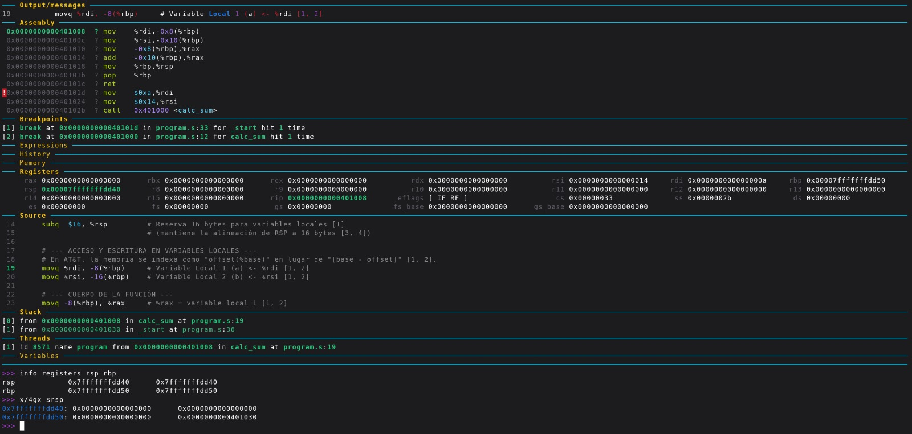

Los tres `stepi` ejecutan el prólogo completo: `pushq %rbp`, `movq %rsp,%rbp` y `subq $16,%rsp`. Ahora `%rbp` = `…dd50` y `%rsp` = `…dd40`.

**Cómo se lee `x/4gx $rsp`:** examinar (`x`) 4 elementos de 8 bytes (`g`, *giant word*) en hexadecimal (`x`), empezando en `%rsp`.

Las dos variables locales todavía valen 0: el espacio está reservado pero no se escribió nada.

## 2.6 Las variables locales

```
stepi
stepi
x/4gx $rsp
```

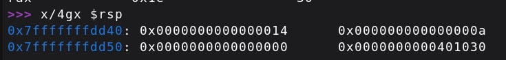

Los dos `stepi` ejecutan `movq %rdi,-8(%rbp)` y `movq %rsi,-16(%rbp)`, que copian los argumentos de los registros a la memoria del marco.

| Dirección | Offset desde `%rsp` | Equivale a | Contenido |
|---|---|---|---|
| `…dd40` | +0 | `-16(%rbp)` | variable local `b` = `0x14` (20) |
| `…dd48` | +8 | `-8(%rbp)` | variable local `a` = `0xa` (10) |
| `…dd50` | +16 | `0(%rbp)` | el `%rbp` del llamador (`0`, porque `_start` no tenía marco) |
| `…dd58` | +24 | `8(%rbp)` | dirección de retorno `0x401030` |

`%rbp` funciona como **frontera** del marco: los offsets **positivos** son datos que puso el que llamó, y los **negativos** son las variables locales de esta función.

## 2.7 El cuerpo

```
stepi
stepi
info registers rax
```

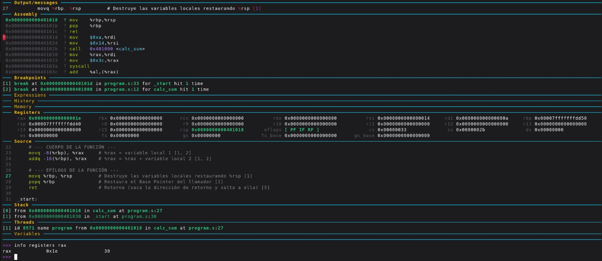

La función lee las dos locales desde la pila y las suma: **`%rax` = `0x1e` = 30**, que es el registro donde la convención manda devolver el resultado. En el panel Source se ve que la próxima instrucción es el epílogo: `movq %rbp,%rsp`.

## 2.8 El epílogo

```
stepi
stepi
info registers rsp rbp
x/1gx $rsp
```

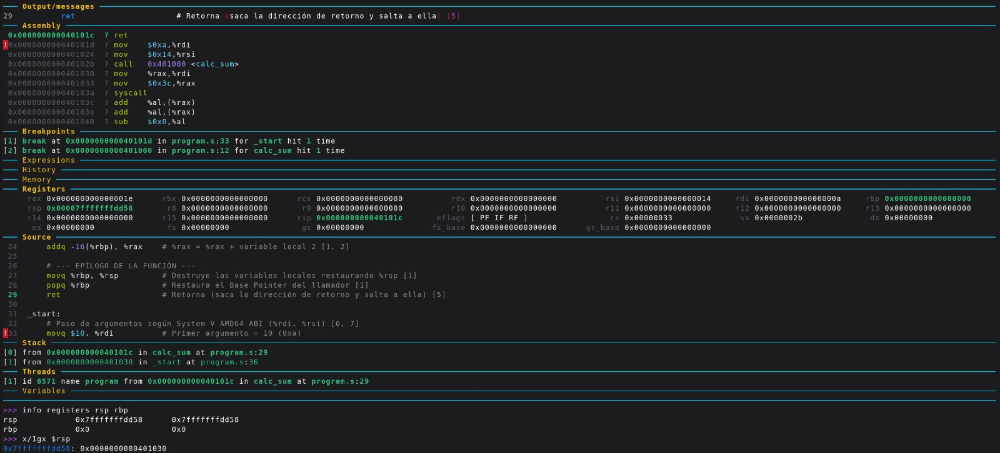

El epílogo deshace el prólogo:

- `movq %rbp,%rsp` libera las locales.
- `popq %rbp` restaura el base pointer del llamador.

Quedan `%rsp` = `…dd58` y `%rbp` = `0`, los mismos valores que había justo después del `call`. En la cima vuelve a estar `0x401030`, y esa es la dirección que va a usar el `ret`.

## 2.9 El retorno

```
stepi
info registers rip rsp
```

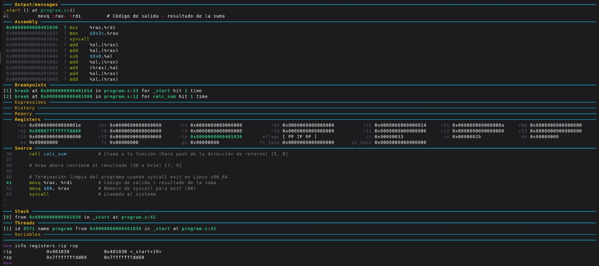

El `ret` saca `0x401030` de la pila y salta ahí:

- **`%rip` = `0x401030` = `_start+19`**, el mismo número del paso 2.4.
- **`%rsp` = `…dd60`**, el mismo valor del paso 2.2.

El recorrido completo de `%rsp` durante la llamada:

```
inicio  →  call  →  push %rbp  →  sub $16  →  mov %rbp,%rsp  →  pop %rbp  →  ret
 dd60      dd58       dd50          dd40          dd50            dd58        dd60
```

Baja y sube en **perfecta simetría**. Si esa simetría se rompiera, por ejemplo si faltara el `popq %rbp`, el `ret` sacaría un valor equivocado y el programa saltaría a una dirección cualquiera.

## 2.10 Código de salida

```
continue
```

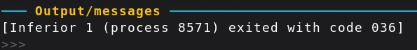

GDB informa `exited with code 036`. El número está en **octal**: 036₈ = 3·8 + 6 = **30**, el mismo valor que dio `echo $?` en el paso 2.1.

---

# Parte 3: C llamando a ensamblador (argumentos por registros)

Ahora un programa en C llama a una rutina escrita en ensamblador y enlazada por separado. `suma.s` es mínimo:

```asm
suma:
    movq %rdi, %rax   # rax = a
    addq %rsi, %rax   # rax = a + b
    ret
```

## 3.1 Compilar con símbolos de depuración

```bash
as --64 -g -o suma.o suma.s
gcc -g3 -O0 -c main.c -o main.o
gcc -g3 -O0 -no-pie main.o suma.o -o programa
./programa
nm suma.o
grep -n 'suma(a, b)' main.c
```

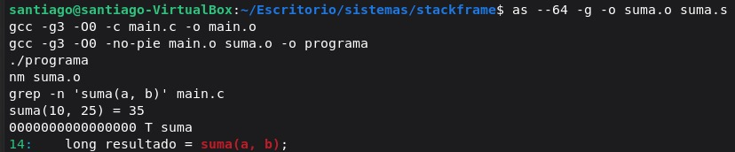

- **`-g3`** incorpora la información de depuración.
- **`-O0`** desactiva las optimizaciones. Con optimizaciones, el compilador puede eliminar el marco o dejar las variables solo en registros, y la sesión de GDB no se correspondería con el código fuente.
- **`-no-pie`** fija las direcciones de código (`0x401…`), así son comparables entre máquinas.
- Se enlaza con **`gcc`** y no con `ld`, porque `main.c` usa `printf` y necesita la biblioteca de C.

El programa imprime `suma(10, 25) = 35`. `nm` devuelve **`T suma`**: la `T` significa que el símbolo es global y está en la sección `.text`, así que el enlazador lo encuentra desde `main.o`. El `grep` muestra que la llamada está en la línea 14.

## 3.2 Cómo prepara el compilador la llamada

```bash
gdb ./programa
```

```
break main.c:14
run
set $rsp_antes = $rsp
dashboard expressions watch $rsp_antes - $rsp
dashboard memory watch $rsp-16 16
disassemble main
```

Desde esta parte usamos dos herramientas del dashboard:

- **`$rsp_antes - $rsp`**, en el panel **Expressions**: guarda `%rsp` antes de la llamada y muestra en cada paso cuántos bytes creció la pila. Esa diferencia no depende de la máquina.
- **`memory watch`**, en el panel **Memory**: muestra en hexadecimal la zona de la pila que nos interesa.

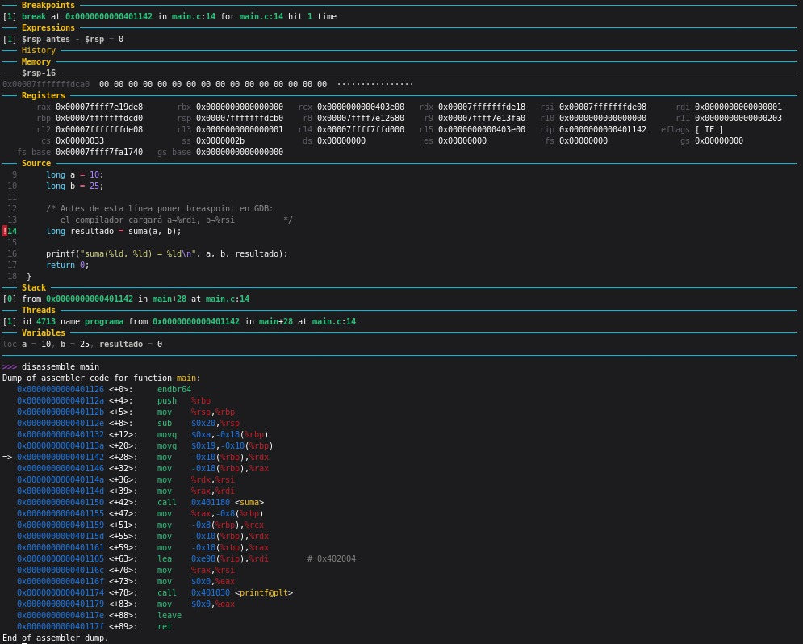

El desensamblado muestra el ciclo completo de una llamada, generado **automáticamente** por GCC:

| Dirección | Instrucción | Qué hace |
|---|---|---|
| `0x401132` | `movq $0xa,-0x18(%rbp)` | `a` = 10, en una variable local |
| `0x40113a` | `movq $0x19,-0x10(%rbp)` | `b` = 25, en una variable local |
| `0x401142` … `0x40114d` | `mov … %rdx` / `%rax` → `%rsi` / `%rdi` | recupera `a` y `b` y los acomoda en los registros de argumentos |
| `0x401150` | `call 0x401180 <suma>` | llama |
| `0x401155` | `mov %rax,-0x8(%rbp)` | guarda el resultado en `resultado` |

Ninguna de esas instrucciones la escribió nadie a mano: es el compilador cumpliendo la System V AMD64 ABI por su cuenta. Ese contrato es lo que permite que dos archivos compilados por separado, uno en C y otro en ensamblador, se entiendan.

## 3.3 Los argumentos, justo antes del `call`

```
stepi
stepi
stepi
stepi
info registers rip rdi rsi
```

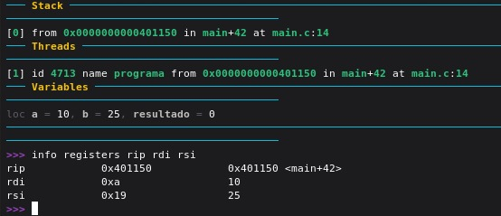

Después de cuatro instrucciones, la ejecución está sobre el `call` (`%rip` = `0x401150`, `main+42`), con **`%rdi` = 10** y **`%rsi` = 25**. La pila todavía no se tocó: Expressions vale 0.

## 3.4 Adentro de `suma`

```
stepi
x/1gx $rsp
disassemble suma
```

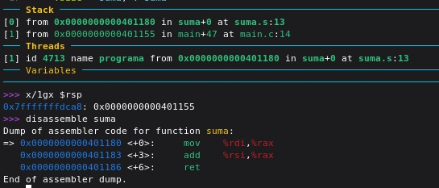

- **`%rsp` bajó 8 bytes**, de `…dcb0` a `…dca8`: el `call` empujó la dirección de retorno.
- En la cima está **`0x401155`**, que es **`main+47`**: la instrucción `mov %rax,-0x8(%rbp)` del paso 3.2. El panel Stack lo confirma: el marco `[1]` está en `0x401155 in main+47`.

**`suma` no arma marco de pila**: son tres instrucciones (`mov`, `add`, `ret`) sin prólogo ni epílogo. Es una *función hoja*: no llama a otra rutina ni usa variables locales, así que no necesita marco propio. Contrasta con `calc_sum` de la Parte 2, que sí lo arma. **El prólogo no es un ritual obligatorio, sino una herramienta que se usa cuando hace falta.**

## 3.5 El valor de retorno

```
stepi
stepi
info registers rax
stepi
info registers rip rsp rax
```

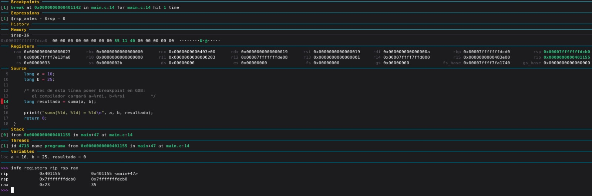

- **`%rax` = `0x23` = 35** = 10 + 25.
- Después del `ret`, `%rip` = `0x401155` (`main+47`) y `%rsp` = `…dcb0`: volvió a su valor original y Expressions marca 0.
- En el panel **Memory** todavía se lee `55 11 40 00…` en `…dca8`, que es `0x401155` en little-endian. El `ret` **no borra** la dirección de retorno: solo mueve `%rsp` por encima de ella. El dato queda como basura debajo de la cima de la pila.

---

# Parte 4: argumentos por la pila

En la System V AMD64 ABI, los primeros seis argumentos enteros viajan por registros (`%rdi`, `%rsi`, `%rdx`, `%rcx`, `%r8` y `%r9`). Esta parte estudia lo que el trabajo práctico necesita: **qué pasa cuando los argumentos deben ir por la pila**.

`main2.c` llama a dos rutinas cuyo cuerpo es idéntico. Las dos leen sus operandos en `16(%rbp)` y `24(%rbp)`, los suman en `%rax` y retornan. Lo que cambia es **quién** pone los argumentos en la pila:

| Variante | Rutina | Quién empuja los argumentos |
|---|---|---|
| A | `suma_por_pila` (`suma_por_pila.s`) | el **compilador**: la función se declara con ocho parámetros, y el 7.º y el 8.º no tienen registro asignado |
| B | `suma_stack` (`suma2.s`) | el **programador**, con ensamblador en línea (`__asm__`) que emula la convención cdecl de 32 bits |

## 4.1 Compilar

```bash
as --64 -g -o suma2.o suma2.s
as --64 -g -o suma_por_pila.o suma_por_pila.s
gcc -g3 -O0 -c main2.c -o main2.o
gcc -g3 -O0 -no-pie main2.o suma2.o suma_por_pila.o -o programa2
./programa2
```

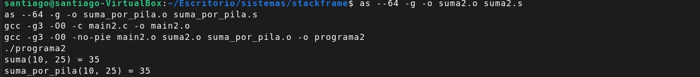

Las dos variantes devuelven 35. El resto de la parte analiza *cómo* llegan los argumentos.

Las llamadas están en la línea 41 (`suma_por_pila`) y en la línea 25 (el bloque `__asm__`):

```bash
grep -n -E '__asm__|res_pila =' main2.c
```

## Variante A: `suma_por_pila`

```c
extern long suma_por_pila(long r1, long r2, long r3, long r4, long r5, long r6, long a, long b);
long res_pila = suma_por_pila(0, 0, 0, 0, 0, 0, 10, 25);
```

### 4.2 Cómo prepara el compilador una llamada con ocho argumentos

```bash
gdb ./programa2
```

```
set pagination off
break main2.c:41
break *suma_por_pila
run
set $rsp_antes = $rsp
dashboard expressions watch $rsp_antes - $rsp
dashboard memory watch $rsp-32 32
x/11i $pc
```

`break *suma_por_pila` lleva **asterisco** para que GDB se detenga en la primera instrucción de la rutina, antes del prólogo. Sin el asterisco, GDB a veces saltea el prólogo, que es justo lo que queremos ver.

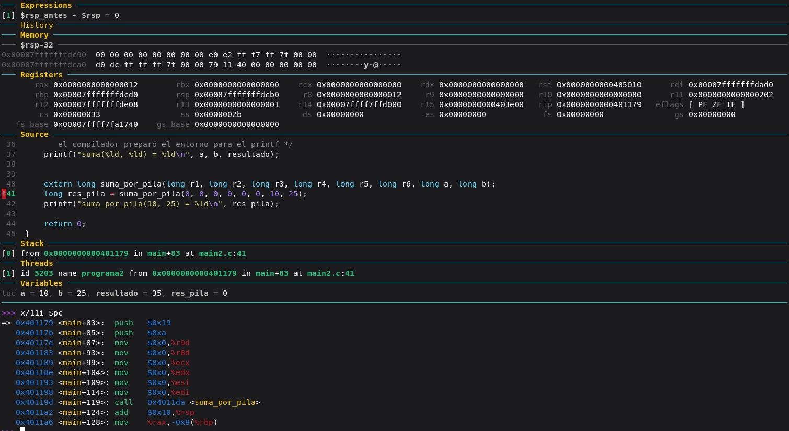

| Dirección | Instrucción | Efecto |
|---|---|---|
| `0x401179` | `push $0x19` | 8.º argumento (`b` = 25) a la pila |
| `0x40117b` | `push $0xa` | 7.º argumento (`a` = 10) a la pila |
| `0x40117d` … `0x401198` | `mov $0x0,%r9d` … `mov $0x0,%edi` | argumentos 6.º a 1.º, en registros |
| `0x40119d` | `call 0x4011da <suma_por_pila>` | empuja la dirección de retorno y salta |
| `0x4011a2` | `add $0x10,%rsp` | descarta los 16 bytes de argumentos |

- **Los argumentos de pila se empujan de derecha a izquierda**: primero el 8.º y después el 7.º. Como la pila crece hacia abajo, el último empujado queda más cerca de la función llamada. Así el 7.º argumento queda siempre a la misma distancia de la dirección de retorno, sin importar cuántos argumentos haya en total.
- **Los registros se cargan después de los `push` y antes del `call`.**
- **Dos argumentos de 8 bytes suman 16**, así que se conserva la alineación a 16 que la ABI exige en el `call` (ver Parte 5). Con un número impar de argumentos en la pila, el compilador agregaría 8 bytes de relleno.

`%rsp` vale `…dcb0` antes de la llamada, y ese es el valor que guardamos en `$rsp_antes`.

### 4.3 Los `push`

```
nexti
nexti
x/2gx $rsp
```

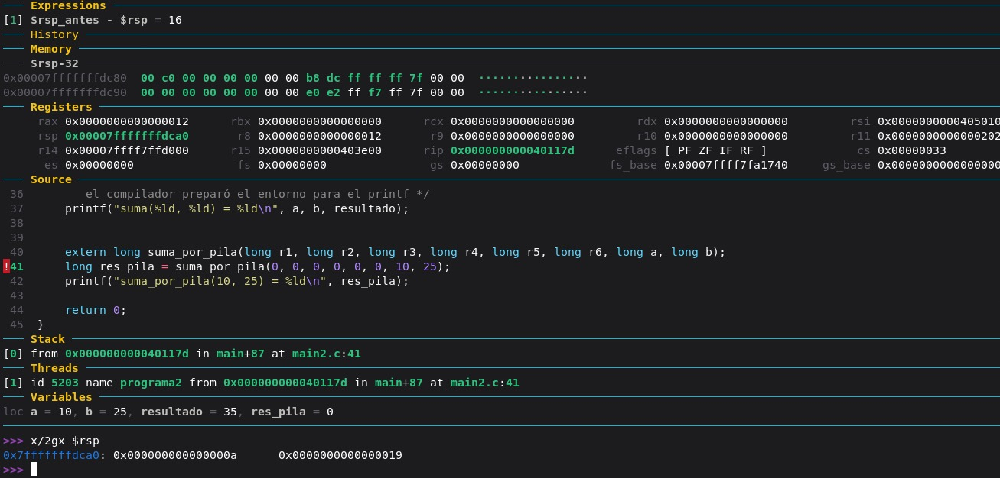

La pila creció **16 bytes** (Expressions = 16): `%rsp` = `…dca0`. En la cima está `0xa` y justo encima `0x19`.

### 4.4 Al entrar a la función, antes del prólogo

```
continue
info registers rdi rsi rdx rcx r8 r9
x/3gx $rsp
x/1i *(long *)$rsp
```

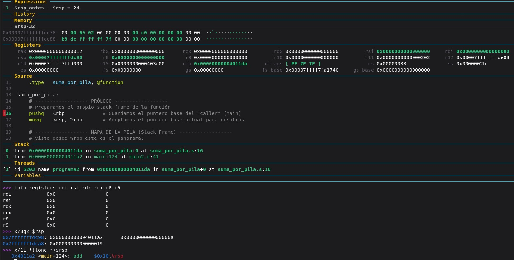

- Los seis registros de argumentos valen **0**: son los seis ceros de la llamada, que la rutina ignora.
- La pila creció **24 bytes**: los 16 de los argumentos más los 8 que empujó el `call`.
- La cima (`…dc98`) contiene **`0x4011a2`**, y al desensamblarla aparece `add $0x10,%rsp`. **La dirección de retorno apunta a la instrucción de limpieza del llamador**, que es lo primero que se ejecuta al volver.

### 4.5 El marco de `suma_por_pila`

```
stepi
stepi
p $rbp == $rsp
x/4gx $rbp
x/1gd $rbp+16
x/1gd $rbp+24
```

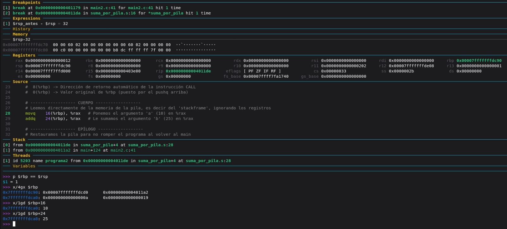

Después del prólogo (`pushq %rbp` y `movq %rsp,%rbp`), `%rbp` queda igual a `%rsp` (`$rbp == $rsp` da 1) y la pila creció **32 bytes**.

| Dirección | Desde `%rbp` | Contenido | Lo escribió |
|---|---|---|---|
| `…dca8` | `24(%rbp)` | `0x19` = 25 → 8.º argumento (`b`) | `main` (`push $0x19`) |
| `…dca0` | `16(%rbp)` | `0xa` = 10 → 7.º argumento (`a`) | `main` (`push $0xa`) |
| `…dc98` | `8(%rbp)` | `0x4011a2` → dirección de retorno | `call` |
| `…dc90` | `0(%rbp)` | `0x7fffffffdcd0` → `%rbp` de `main` | `pushq %rbp` |

`x/1gd $rbp+16` y `x/1gd $rbp+24` devuelven **10** y **25**: son exactamente las posiciones de las que la rutina lee sus operandos. **Esta es la evidencia de que los parámetros viajaron por la pila.**

El `%rbp` guardado de `main` (`…dcd0`) está 0x20 bytes por encima de `$rsp_antes` (`…dcb0`). Eso coincide con los 32 bytes de locales que reservó el prólogo de `main`. Los dos marcos quedan encadenados a través de `%rbp`.

### 4.6 Cuerpo y retorno

```
stepi
stepi
p $rax
stepi
stepi
x/2gx $rsp
```

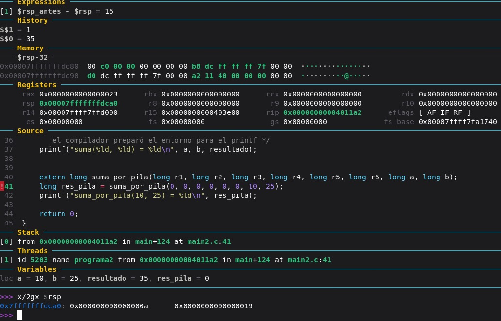

- Después de `movq 16(%rbp),%rax` y `addq 24(%rbp),%rax`, **`%rax` = 35**.
- Después de `popq %rbp` y `ret`, la ejecución está de nuevo en `main`, sobre el `add $0x10,%rsp` de `0x4011a2`.
- **La diferencia de la pila todavía es 16**, y `x/2gx $rsp` sigue mostrando `0xa` y `0x19`: los argumentos siguen en la pila. **El `ret` solo extrajo la dirección de retorno.**

### 4.7 Limpieza a cargo del llamador

```
nexti
p $rsp_antes - $rsp
```

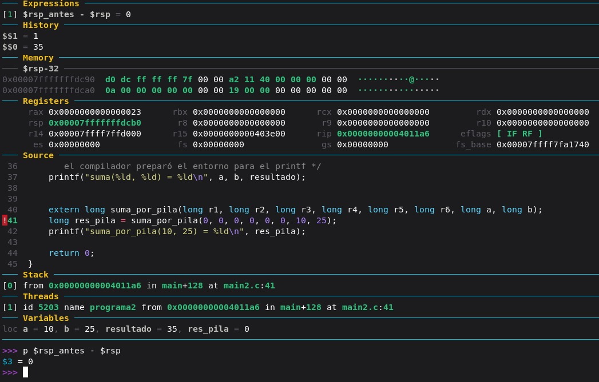

Después del `add $0x10,%rsp`, la diferencia vuelve a **0**: `%rsp` = `…dcb0`, el valor de antes de la llamada. En la System V AMD64 ABI, **limpia el llamador**.

En el panel Memory los valores `0a` y `19` siguen escritos en `…dca0`: limpiar la pila es **mover `%rsp`**, no borrar los datos.

```
continue
quit
```

## Variante B: `suma_stack` (push a mano)

En la primera mitad de `main2.c`, la función se declara sin parámetros (`extern long suma_stack(void)`) y los argumentos se colocan con un bloque de ensamblador en línea:

```c
__asm__ (
    "pushq %[b]\n\t"
    "pushq %[a]\n\t"
    "call suma_stack\n\t"
    "addq $16, %%rsp\n\t"
    : "=a" (resultado)
    : [a] "r" (a), [b] "r" (b)
    : "memory"
);
```

### 4.8 El bloque `__asm__` en el binario

Este bloque se ejecuta **antes** que la llamada de la variante A, así que va en una sesión nueva:

```bash
gdb ./programa2
```

```
set pagination off
break main2.c:25
break *suma_stack
run
set $rsp_antes = $rsp
dashboard expressions watch $rsp_antes - $rsp
dashboard memory watch $rsp-32 32
x/8i $pc
```

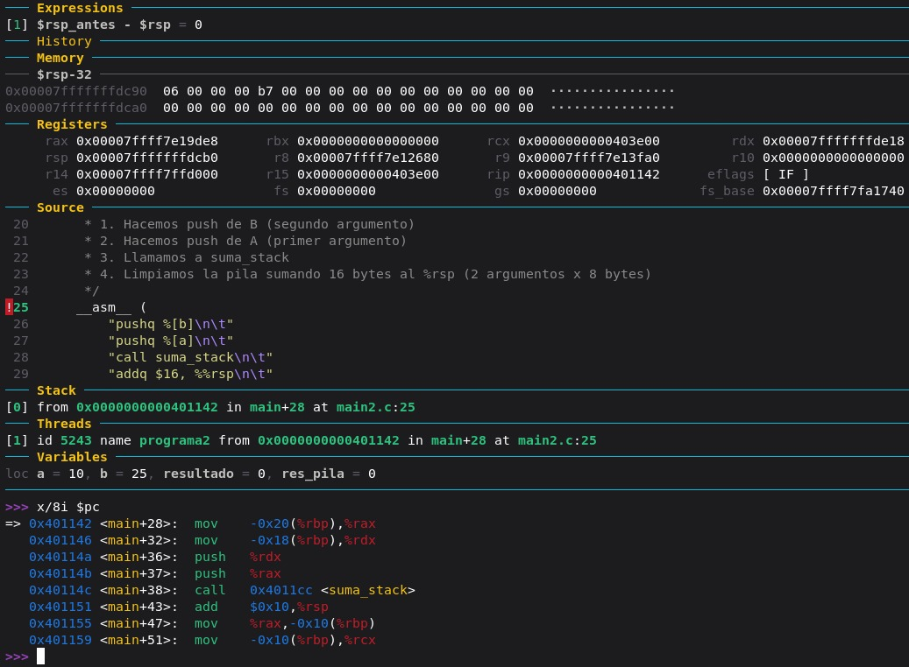

Hay dos tipos de instrucciones:

- **Las que agregó el compilador**, en `0x401142` y `0x401146`: cargan `a` desde `-0x20(%rbp)` en `%rax` y `b` desde `-0x18(%rbp)` en `%rdx`. Lo hace porque las restricciones `"r"` le piden los valores en registros cualesquiera.
- **Las que escribió el programador**, copiadas textualmente: `push %rdx`, `push %rax`, `call suma_stack` y `add $0x10,%rsp`.

### 4.9 Los `push` manuales

```
nexti
nexti
info registers rax rdx
nexti
nexti
x/2gx $rsp
```

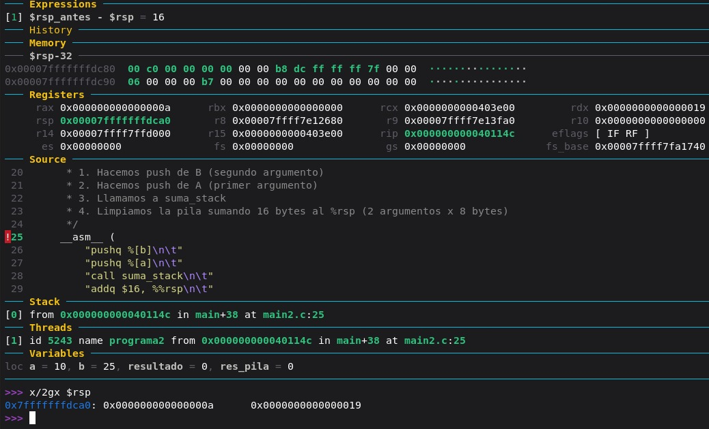

`%rax` = 10 y `%rdx` = 25 (se ven en el panel Registers). Después de los dos `push`, la pila creció **16 bytes** y contiene `0xa` y `0x19` en `…dca0`: **las mismas direcciones que en la variante A**.

### 4.10 Entrada a `suma_stack`

```
continue
x/3gx $rsp
x/1i *(long *)$rsp
```

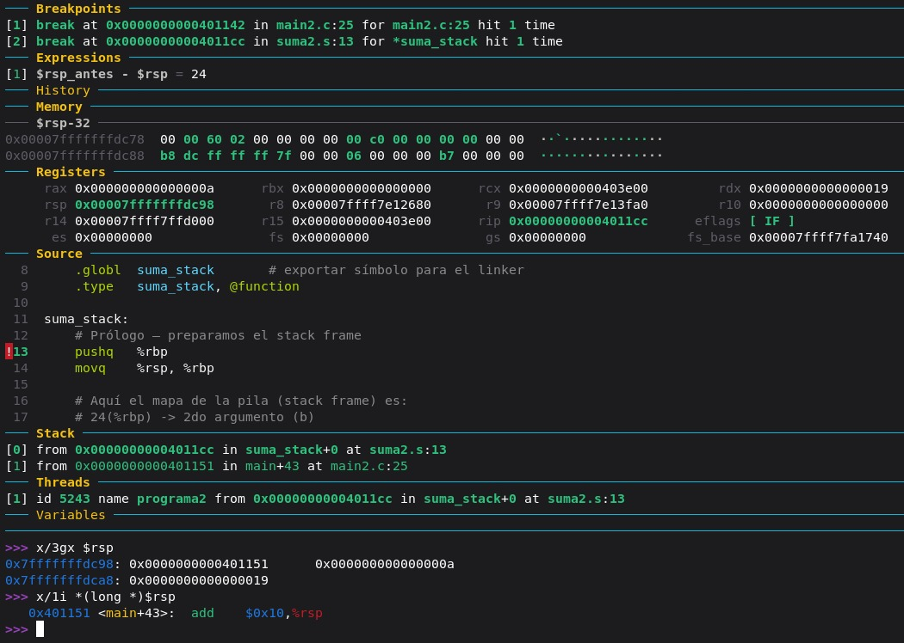

La pila creció **24 bytes**. La dirección de retorno es **`0x401151`**, que apunta a `add $0x10,%rsp`: otra vez, la instrucción de limpieza.

### 4.11 El marco de `suma_stack`

```
stepi
stepi
x/4gx $rbp
x/1gd $rbp+16
x/1gd $rbp+24
```

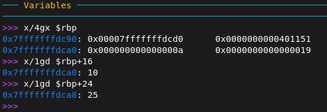

| Desde `%rbp` | Variante A | Variante B |
|---|---|---|
| `0(%rbp)` | `…dcd0` en `…dc90` | `…dcd0` en `…dc90` |
| `8(%rbp)` | `0x4011a2` | `0x401151` |
| `16(%rbp)` | **10** en `…dca0` | **10** en `…dca0` |
| `24(%rbp)` | **25** en `…dca8` | **25** en `…dca8` |

**El marco que recibe la función es idéntico en las dos variantes**: mismas direcciones absolutas y mismos valores. Lo único distinto es la dirección de retorno, porque cada `call` está en un lugar distinto de `main`.

### 4.12 Retorno y limpieza manual

```
stepi
stepi
stepi
stepi
p $rax
nexti
p $rsp_antes - $rsp
```

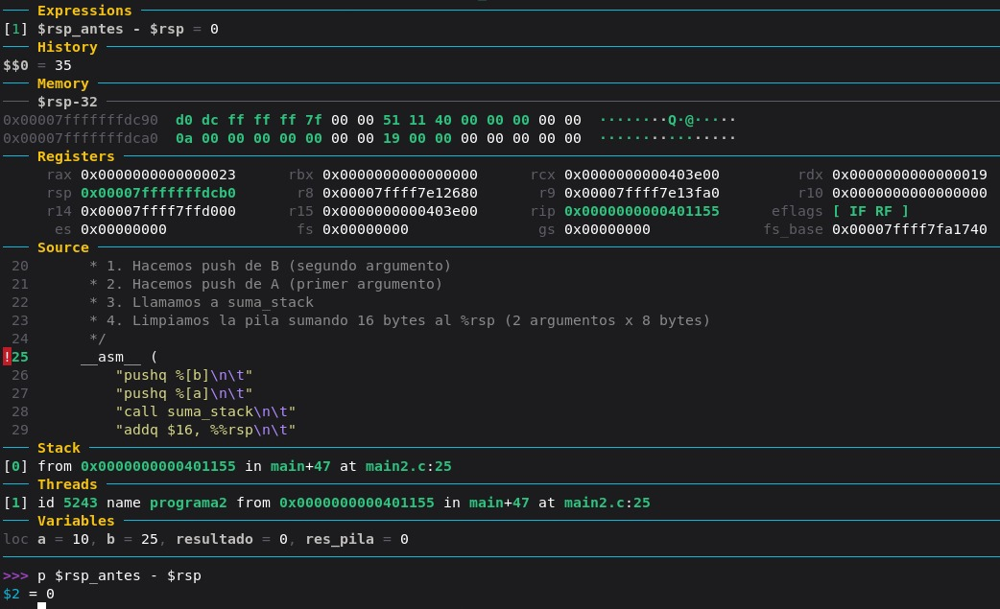

Los cuatro `stepi` ejecutan `movq`, `addq`, `popq` y `ret`, y `%rax` queda en **35**. El `nexti` ejecuta el `add $0x10,%rsp` **escrito por el programador**, y la diferencia vuelve a **0**. Si se lo omitiera, la pila de `main` quedaría desbalanceada en 16 bytes.

En las dos variantes el marco es el mismo. La diferencia está en quién escribe las instrucciones que lo construyen y lo desarman: en la A las genera el compilador a partir del prototipo, y en la B las escribe el programador.

## 4.13 Experimento: la fragilidad del ensamblador en línea

El bloque `__asm__` declara que modifica `%rax` (la salida `"=a"`) y la memoria (`"memory"`). Pero contiene un `call`, y según la ABI la función llamada puede modificar libremente todos los registros *caller-saved* (`%rcx`, `%rdx`, `%rsi`, `%rdi`, `%r8`–`%r11`). El compilador no lee el texto del bloque, así que no se entera.

Para comprobar que es un riesgo real, armamos una versión de `suma_stack` que además pone en cero `%rdx` y `%rcx`. Según la ABI, eso es **legal**:

```bash
mkdir -p experimento
cd experimento
cat > suma2_pisa.s << 'EOF'
    .text
    .globl  suma_stack
suma_stack:
    pushq   %rbp
    movq    %rsp, %rbp
    movq    16(%rbp), %rax
    addq    24(%rbp), %rax
    xorq    %rdx, %rdx
    xorq    %rcx, %rcx
    popq    %rbp
    ret
    .section .note.GNU-stack,"",@progbits
EOF
sed 's/: "memory"/: "memory", "cc", "rcx", "rdx", "rsi", "rdi", "r8", "r9", "r10", "r11"/' ../main2.c > main2_clobbers.c
as --64 -o suma2_pisa.o suma2_pisa.s
gcc -O0 ../main2.c suma2_pisa.o ../suma_por_pila.o -o exp_O0
gcc -O2 ../main2.c suma2_pisa.o ../suma_por_pila.o -o exp_O2
gcc -O2 main2_clobbers.c suma2_pisa.o ../suma_por_pila.o -o exp_O2_fix
echo "== -O0 ==" && ./exp_O0
echo "== -O2 ==" && ./exp_O2
echo "== -O2 con clobbers ==" && ./exp_O2_fix
objdump -d --no-show-raw-insn exp_O2 | grep -A16 '<main>:'
```

`main2_clobbers.c` es `main2.c` con la lista de clobbers completa.

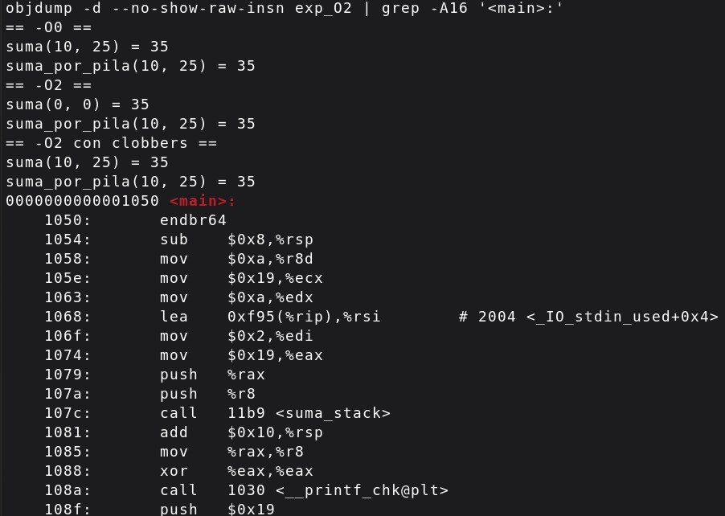

| Compilación | Primera línea |
|---|---|
| `main2.c`, `-O0` | `suma(10, 25) = 35` |
| `main2.c`, `-O2` | **`suma(0, 0) = 35`** |
| `main2_clobbers.c`, `-O2` | `suma(10, 25) = 35` |

El desensamblado de `-O2` explica el fallo. El compilador carga los argumentos del `printf` **antes** del bloque `__asm__`: `%rdx` = `a` = 10 y `%rcx` = `b` = 25. Después del `call suma_stack`, solo mueve el resultado a `%r8` y llama a `__printf_chk`, convencido de que `%rdx` y `%rcx` siguen intactos. Como la rutina los puso en cero, se imprime `suma(0, 0)`. La suma en sí es correcta, porque viaja en `%rax`, que sí está declarado.

Con `-O0` el problema queda oculto, porque el compilador guarda cada variable en memoria y la vuelve a cargar antes de usarla. **El programa original funciona por casualidad, no por contrato.**

La variante A no tiene este problema: el compilador ve un prototipo real, conoce la ABI y sabe qué registros se pierden en cada `call`.

## Respuestas de la Parte 4

**¿Por qué el séptimo argumento queda en `16(%rbp)` y no en `8(%rbp)`?**
Porque entre el último argumento empujado y `%rbp` hay dos quadwords que no son argumentos. La dirección de retorno que deposita el `call` queda en `8(%rbp)`, y el `%rbp` del llamador que guarda el prólogo queda en `0(%rbp)`.

**¿Quién limpia la pila?**
El llamador. El `ret` solo extrae la dirección de retorno, y los argumentos siguen ahí (diferencia 16) hasta el `add $0x10,%rsp` de `main` (diferencia 0).

**¿En qué se diferencia `suma_por_pila` de `calc_sum` (Parte 2)?**

| | `calc_sum` | `suma_por_pila` |
|---|---|---|
| Recibe los argumentos | en registros (`%rdi`, `%rsi`) | en la pila, escritos por el llamador |
| Los lee de | sus locales, en `-8(%rbp)` y `-16(%rbp)` | `16(%rbp)` y `24(%rbp)` |
| Desplazamientos | negativos: memoria **propia** del marco | positivos: memoria **del llamador** |
| Reserva de locales | `subq $16, %rsp` | ninguna |
| Epílogo | `movq %rbp,%rsp` y después `popq %rbp` | alcanza con `popq %rbp` |

---

# Parte 5: detalles de la ABI que te pueden morder

La `GUIA.md` enumera tres reglas de la ABI que no aparecen en los ejemplos del profesor. Para verlas, armamos **un experimento por regla**, cada uno con una versión que la respeta y otra que no.

```bash
cd ~/Escritorio/sistemas
mkdir parte5
cd parte5
```

## 5.1 Alineación de la pila a 16 bytes

**La regla:** justo antes de ejecutar un `call`, `%rsp` tiene que ser múltiplo de 16. El `call` empuja 8 bytes, así que al entrar a una función `%rsp` termina en 8, y el `pushq %rbp` del prólogo lo vuelve a alinear.

`alineacion.s` tiene dos rutinas que llaman a `printf` con un entero y un `double`:

```asm
# Respeta la ABI: el prologo deja %rsp multiplo de 16 antes del call
printf_alineado:
        pushq   %rbp
        movq    %rsp, %rbp
        movq    %rdi, %rsi
        leaq    fmt(%rip), %rdi
        movl    $1, %eax            # %al = 1: hay 1 argumento en %xmm0
        call    printf
        popq    %rbp
        ret

# NO respeta la ABI: llama a printf sin prologo
printf_desalineado:
        movq    %rdi, %rsi
        leaq    fmt(%rip), %rdi
        movl    $1, %eax
        call    printf
        ret
```

`alineacion.c` llama a una o a otra según el argumento de la línea de comandos.

```bash
as --64 -g -o alineacion_asm.o alineacion.s
gcc -g3 -O0 -no-pie alineacion.c alineacion_asm.o -o alineacion
./alineacion
./alineacion mal
```

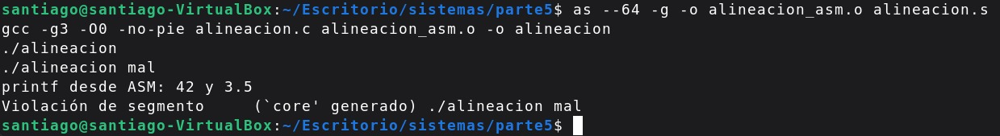

La versión alineada imprime `printf desde ASM: 42 y 3.5`. La desalineada termina en **`Violación de segmento`**.

**En GDB, versión alineada:**

```
break *printf_alineado
run
dashboard expressions watch (long)$rsp & 0xf
stepi
stepi
stepi
stepi
stepi
x/i $pc
```

`(long)$rsp & 0xf` es el resto de dividir `%rsp` por 16. Al entrar a la función vale 8, por el `call` que la invocó.

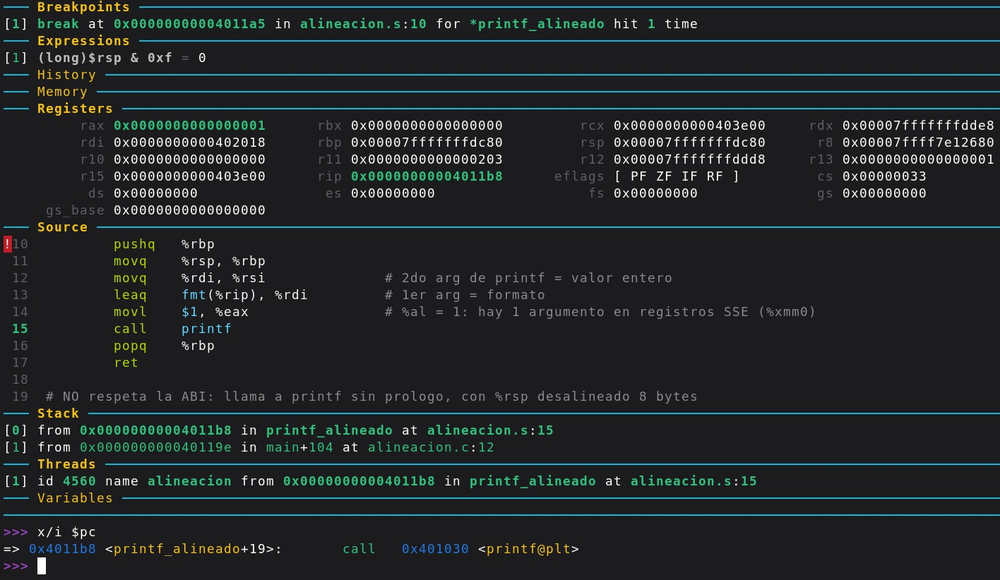

Sobre el `call printf` (`0x4011b8`), Expressions vale **0**: el `pushq %rbp` alineó la pila (`%rsp` = `…dc80`).

**En GDB, versión desalineada:**

```
break *printf_desalineado
run mal
dashboard expressions watch (long)$rsp & 0xf
stepi
stepi
stepi
x/i $pc
continue
x/i $pc
bt
```

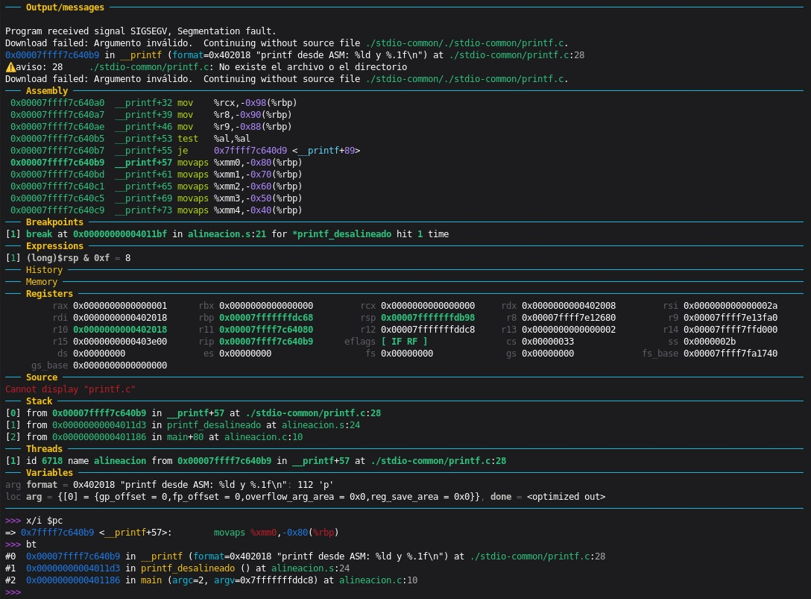

Sobre el `call printf`, Expressions vale **8**. Al continuar, el programa recibe `SIGSEGV` dentro de `__printf`, en la instrucción **`movaps %xmm0,-0x80(%rbp)`**.

`movaps` guarda los 16 bytes de un registro SSE y **exige una dirección múltiplo de 16**. Como `%rbp` = `0x7fffffffdc68`, la dirección destino es `0x7fffffffdc68 - 0x80 = 0x7fffffffdbe8`, que termina en 8. El `bt` muestra la cadena `main` → `printf_desalineado` → `__printf`.

**Cómo se arregla:** con un prólogo, como `printf_alineado`, o con `subq $8, %rsp` antes del `call` y `addq $8, %rsp` después.

## 5.2 Registros callee-saved

**La regla:** `%rbx`, `%rbp` y `%r12`–`%r15` son *callee-saved*. Si una función los usa, tiene que guardarlos al entrar y restaurarlos antes de volver. El compilador **confía** en eso y guarda ahí los valores que necesita después de una llamada.

`callee.s` tiene dos rutinas que devuelven `2 * n` usando `%rbx`:

```asm
# Respeta la ABI: guarda y restaura %rbx
doble_respeta:
        pushq   %rbx
        movq    %rdi, %rbx
        addq    %rbx, %rbx
        movq    %rbx, %rax
        popq    %rbx
        ret

# NO respeta la ABI: devuelve %rbx pisado
doble_rompe:
        movq    %rdi, %rbx
        addq    %rbx, %rbx
        movq    %rbx, %rax
        ret
```

`callee.c` llama dos veces seguidas, `a = doble(10)` y `b = doble(20)`, y después imprime `a` y `b`. Se compila con **`-O2`** a propósito: con `-O0` el compilador guarda todo en memoria y el problema no aparece.

```bash
as --64 -g -o callee_asm.o callee.s
gcc -g3 -O2 -no-pie callee.c callee_asm.o -o callee
./callee
./callee mal
objdump -d --no-show-raw-insn callee | grep -A32 '<main>:'
```

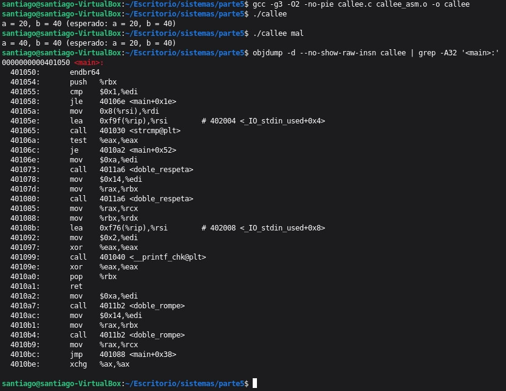

- Con `doble_respeta` se imprime `a = 20, b = 40`.
- Con `doble_rompe` se imprime **`a = 40, b = 40`**.

El `objdump` muestra por qué. Después del primer `call doble_rompe`, el compilador guarda `a` en `%rbx` (`4010b1: mov %rax,%rbx`). Después del segundo, lo vuelve a leer de ahí para pasárselo a `printf` (`401088: mov %rbx,%rdx`). Además, `main` misma respeta la regla: hace `push %rbx` al empezar y `pop %rbx` al terminar.

**En GDB:**

```
break *doble_rompe
run mal
continue
p $rbx
stepi
stepi
stepi
stepi
x/i $pc
p $rbx
```

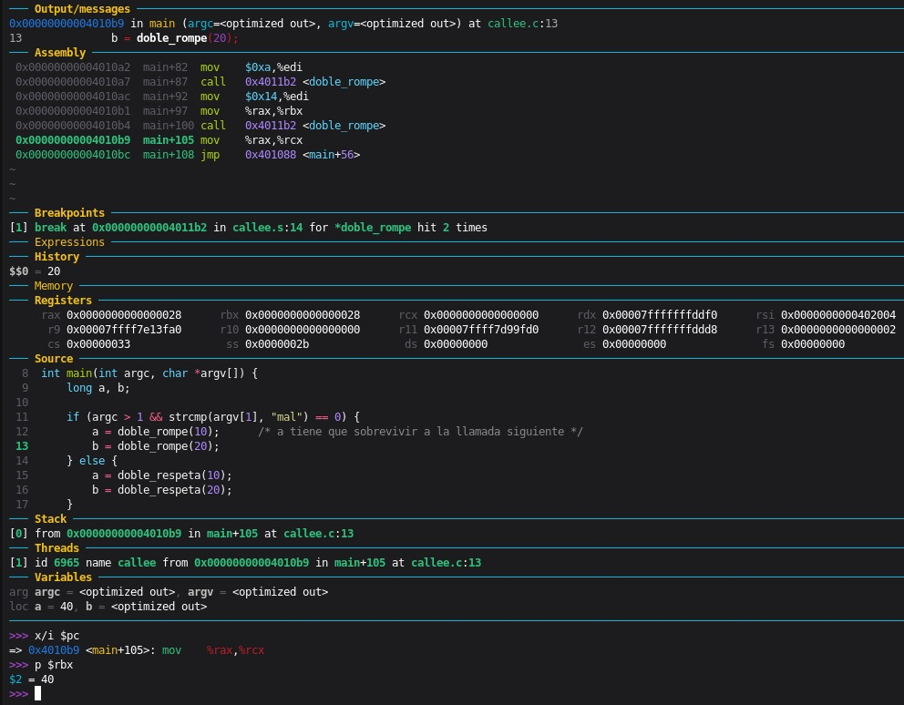

Al entrar a la segunda llamada, `%rbx` = **20**: es `a`, que `main` dejó guardada ahí (se ve en el panel History). Después de ejecutar la rutina y volver a `main` (`main+105`), `%rbx` = **40**. GDB lo confirma en el panel Variables: **`a = 40`**. La rutina pisó un registro que no le pertenecía, y `main` usa el valor equivocado sin enterarse.

## 5.3 La red zone

**La regla:** los 128 bytes que están **debajo** de `%rsp` son una zona que una función *hoja* (que no llama a nadie) puede usar sin mover `%rsp`. Como nadie más va a escribir en la pila mientras la función corre, el compilador lo aprovecha para ahorrarse el `sub`.

`redzone.c` tiene una función hoja y otra que no lo es:

```c
long hoja(long a, long b) {         /* no llama a nadie */
    long x = a * 2;
    long y = b * 3;
    return x + y;
}

long no_hoja(long a, long b) {      /* llama a hoja() */
    long x = a * 2;
    long y = b * 3;
    return hoja(x, y);
}
```

```bash
gcc -g3 -O0 -no-pie redzone.c -o redzone
gcc -g3 -O0 -no-pie -mno-red-zone redzone.c -o redzone_sin
./redzone
objdump -d --no-show-raw-insn redzone | awk '/<hoja>:/,/ret/'
objdump -d --no-show-raw-insn redzone | awk '/<no_hoja>:/,/ret/'
objdump -d --no-show-raw-insn redzone_sin | awk '/<hoja>:/,/ret/'
```

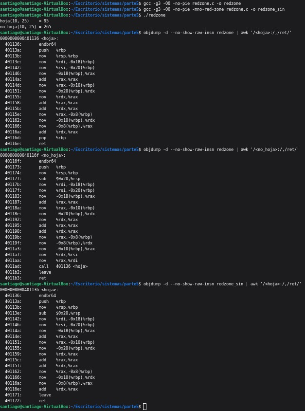

| Función | `sub $0x20,%rsp` | Cierre | Por qué |
|---|---|---|---|
| `hoja` | **no** | `pop %rbp` | escribe en `-0x8` … `-0x20(%rbp)` sin reservar espacio: usa la red zone |
| `no_hoja` | sí | `leave` | llama a `hoja`, y el `call` pisaría esa zona |
| `hoja` con `-mno-red-zone` | sí | `leave` | se le prohibió usar la red zone |

**En GDB:**

```
break redzone.c:8
run
dashboard memory watch $rsp-32 32
p $rsp == $rbp
x/4gd $rsp-32
info locals
```

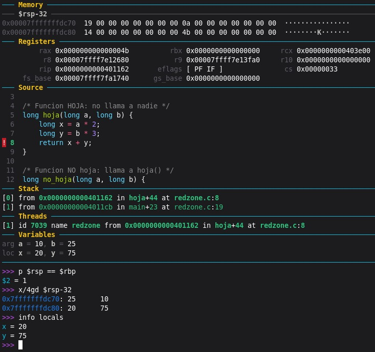

Parados en `return x + y;` dentro de `hoja`:

- `$rsp == $rbp` da **1**: `%rsp` no se movió después del prólogo.
- `x/4gd $rsp-32` muestra **25, 10, 20 y 75**, que son `b`, `a`, `x` e `y`, todos **por debajo** de `%rsp`, en `…dc70`–`…dc8f`.
- El panel Memory muestra los mismos datos en hexadecimal (`19`, `0a`, `14` y `4b`).

La función guarda sus datos en memoria que formalmente no reservó, y es correcto porque la ABI se lo garantiza.

---

# Conclusiones

1. **El pasaje de argumentos responde a un contrato estricto.** Los primeros seis argumentos enteros viajan en `%rdi`, `%rsi`, `%rdx`, `%rcx`, `%r8` y `%r9`, y el valor de retorno vuelve siempre en `%rax`. Lo verificamos en ensamblador escrito a mano (Parte 2) y en código generado por el compilador (Parte 3).
2. **La dirección de retorno es un dato en memoria.** La pone el `call` en la cima de la pila y la saca el `ret`. La ubicamos en direcciones concretas (`0x401030`, `0x401155`, `0x4011a2`, `0x401151`) y la contrastamos con el desensamblado del llamador.
3. **La pila crece hacia direcciones más bajas y se arma y desarma en forma simétrica.** Al terminar cada llamada, `%rsp` y `%rbp` vuelven exactamente a sus valores anteriores.
4. **El prólogo es opcional.** `suma` (Parte 3) no lo tiene, y `calc_sum` (Parte 2) sí. Se usa cuando hace falta.
5. **Cuando hay más de seis argumentos, los que sobran van a la pila de derecha a izquierda**, y la función los encuentra en `16(%rbp)`, `24(%rbp)`, etc. Los 16 bytes anteriores son la dirección de retorno y el `%rbp` guardado. **Limpia el llamador.**
6. **Emular cdecl con `__asm__` produce el mismo marco**, pero es frágil: si no se declaran los registros que el `call` puede pisar, con `-O2` el programa imprime valores incorrectos.
7. **La ABI tiene reglas que no se ven hasta que se rompen.** Una pila desalineada hace caer a `printf`. Un registro callee-saved no restaurado corrompe variables del llamador. Y la red zone explica por qué una función hoja puede usar memoria debajo de `%rsp`.
8. **Para el trabajo práctico conviene la variante A**: pasar los parámetros por la pila declarando más de seis argumentos. Cumple el requisito de usar el stack, respeta la ABI al pie de la letra y deja al compilador a cargo de la alineación, la limpieza y los registros.

---

## Nota sobre las direcciones de memoria

Las direcciones del **stack** (`0x7fffffff…`) dependen de las variables de entorno y de la ruta del binario, así que **cambian entre máquinas y entre corridas**. No es un error. Por ejemplo, `%rsp` arranca en `…dd60` en la Parte 2 y en `…dcb0` en las Partes 3 y 4.

Lo que se mantiene constante son los **valores** (`0xa`, `0x14`, `0x19`, `0x1e`, `0x23`), las direcciones de **código** (fijas gracias a `-no-pie`) y las **diferencias** entre direcciones, que son las que sostienen todo el análisis.
